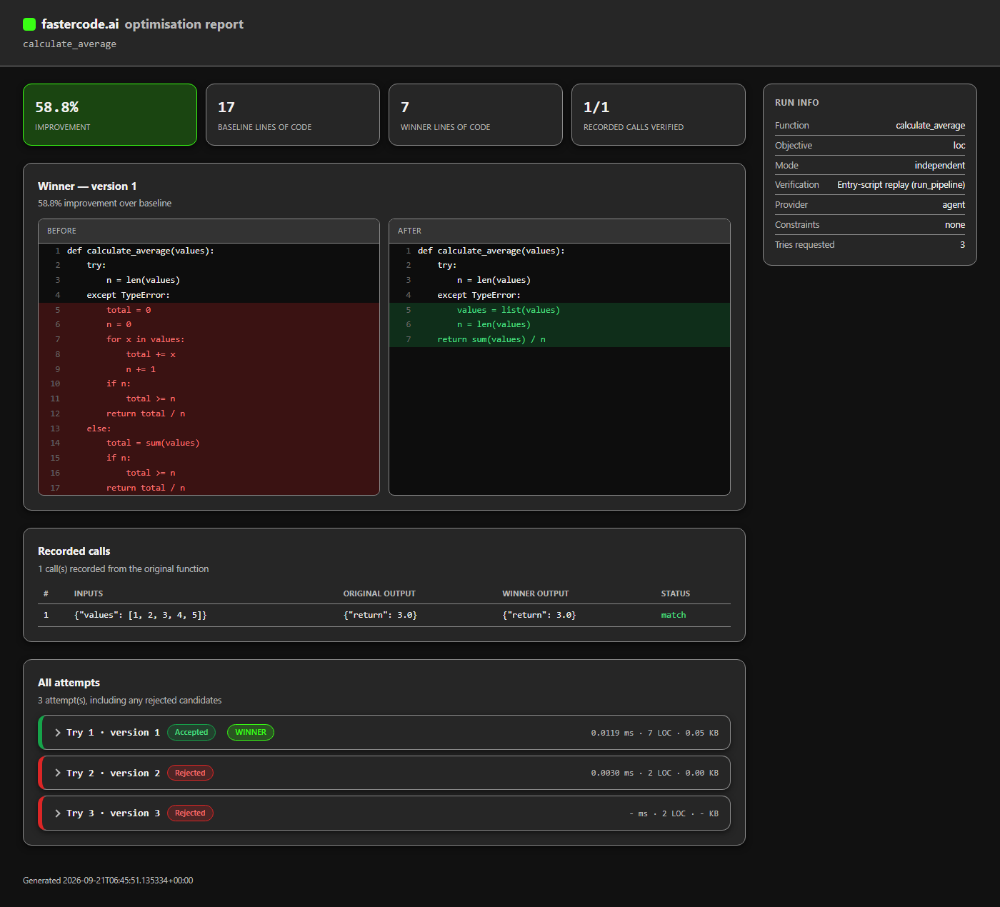

**Make your code faster. Automatically optimise performance and verify every improvement.**

fastercode doesn't just rewrite your functions — it *proves* whether a rewrite is actually better. It replays a function's real recorded calls against every candidate, checks the outputs still match, and measures execution time, lines of code, and peak memory before keeping anything. Rejected candidates are reported honestly, not hidden.

Use it two ways:

- **As a coding agent's referee, via MCP** — your agent (Claude Code, etc.) writes the candidate code; fastercode measures whether it's actually better. No LLM call, no API key needed for this path.
- **As a standalone optimizer, via the Python API** — decorate a function, call `optimise()`, and fastercode calls an LLM (OpenAI, Anthropic, and others) itself to propose and measure candidates.

## Install

```bash
pip install fastercode-ai
```

`mcp` is a standard dependency, so agent mode works right out of the box — no extra install needed.

## Set up the MCP agent

Register the server with your coding agent:

```bash
claude mcp add fastercode -- python -m fastercode.mcp_server
```

Or add it to any MCP client's config:

```json
{
  "mcpServers": {
    "fastercode": {
      "command": "python",
      "args": ["-m", "fastercode.mcp_server"]
    }
  }
}
```

Then just ask your agent to make a function faster. It calls `analyse_function` to see what evidence is available, asks you which recording strategy to use, proposes candidates, and calls `optimise_function` to measure them. See [AGENTS.md](AGENTS.md) for the full workflow and tool reference.

## Basic example — Python API

```python
from fastercode import refactor

# Needs an OPENAI_API_KEY (or another supported provider's key) in the environment.
optimise = refactor(objective="speed")

@optimise.track
def calculate_average(values):
    total = 0
    n = 0
    for x in values:
        total += x
        n += 1
    return total / n

calculate_average([1, 2, 3, 4, 5])  # record at least one real call first

result = optimise.optimise(calculate_average, tries=5)
print(result["report_path"])
```

Every run writes a self-contained `report.html` you can open in any browser — see a real one generated from this exact example: [`examples/example_report.html`](examples/example_report.html).

## What a report looks like



Every attempt is shown, not just the winner: the exact diff, every recorded call's input and output, and the LLM transcript (or "provided directly by agent" in MCP mode) — so a claimed improvement can be checked, not just trusted.

## License

MIT — see [LICENSE](LICENSE).
